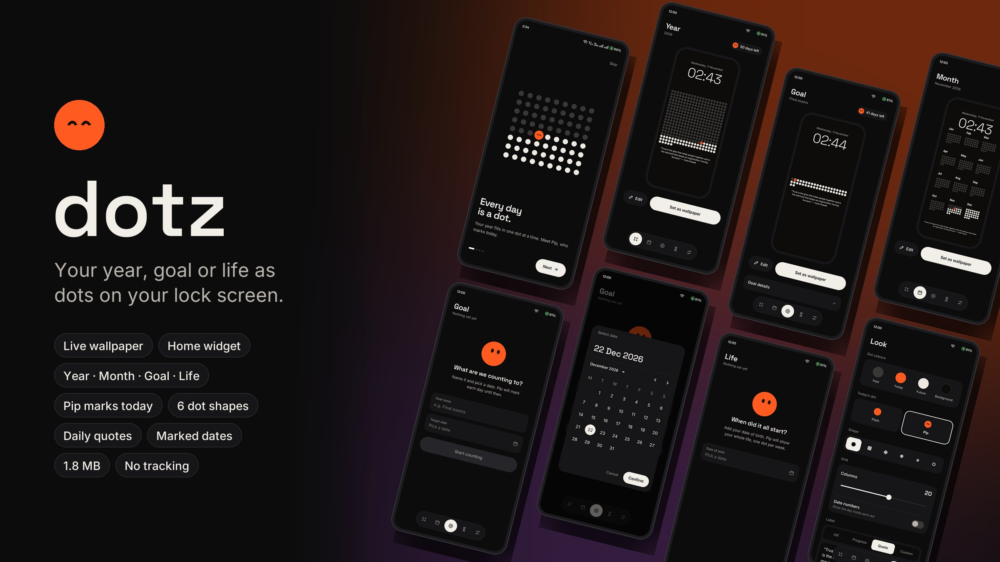
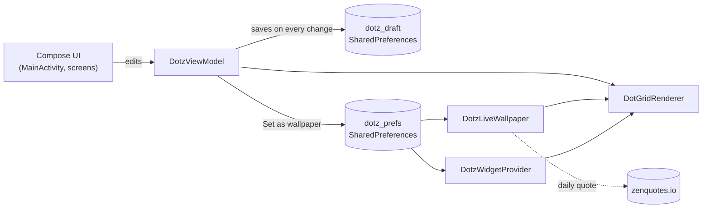

# dotz: live wallpaper

[](https://github.com/harshit36singh/Dotz/actions/workflows/android_ci.yml)
-3A3836)




A native Android app (Kotlin + Jetpack Compose) that turns time into a grid of dots on your wallpaper. Track your year, a month-by-month calendar, a goal countdown, or your whole life. Today's dot is **Pip**, the dotz mascot.

No account, no ads, no analytics. The only network request is an optional daily quote.

---

## Contents

- [Features](#features)
- [How it works](#how-it-works)
- [Getting started](#getting-started)
- [Setting it as your wallpaper](#setting-it-as-your-wallpaper)
- [Home-screen widget](#home-screen-widget)
- [Privacy and permissions](#privacy-and-permissions)
- [Device notes](#device-notes)
- [Releasing](#releasing)
- [Project structure](#project-structure)
- [Troubleshooting](#troubleshooting)
- [Contributing](#contributing)
- [Credits](#credits)

---

## Features

### Four views

| View | One dot is… | Notes |
| --- | --- | --- |
| **Year** | a day of the current year | Past days dim, Pip sits on today, the rest of the year is ahead. |
| **Month** | a day, laid out as 12 month blocks | A calendar view of the whole year. |
| **Goal** | a day between a start date and your target | Name a goal ("Final exams"), pick a date and count down. Start date is editable. |
| **Life** | a week (or a day) of your life | Set your date of birth and a life expectancy from 50 to 110 years. |

### Make it yours

- **Colours** for past, today, future and background dots, each picked from a curated swatch palette.
- **Six dot shapes:** circle, square, diamond, hexagon, star and ring.
- **Grid density:** 7 to 30 columns, plus pinch-to-zoom and drag in the full-screen editor.
- **Date numbers** inside each dot (Year, Month and Goal views), with automatic contrast.
- **Background photo** from your gallery, dimmed so the dots stay readable.
- **Marked dates:** yearly birthdays and anniversaries, highlighted in their own colour in Year and Month views.
- **Today's dot:** a plain dot, or Pip's face.

### Labels under the grid

| Mode | Shows |
| --- | --- |
| Off | Nothing |
| Progress | `50 days left · 86%`, recalculated every day |
| Quote | The quote of the day from [ZenQuotes](https://zenquotes.io), refreshed daily by the wallpaper itself |
| Custom | Your own text |

Label colour and size (auto, or 8–32 sp) are adjustable.

### What you see is what you get

The in-app preview, the live wallpaper and the home-screen widget all draw through the same renderer (`DotGridRenderer.kt`), so they match pixel for pixel.

---

## How it works



- **Draft vs applied.** Everything you edit is saved to a draft straight away, so settings survive restarts. The wallpaper only changes when you tap **Set as wallpaper**.
- **Dates, not snapshots.** Goal and Life store real dates (start, target, birth), so the wallpaper moves forward on its own every midnight. You never need to reopen the app.
- **Battery.** The wallpaper renders the grid once into a cached bitmap and only redraws it when the day changes or settings change. While it's visible, a once-a-minute check just compares the date.
- **Widget.** The widget redraws on an alarm set just after midnight, when it's resized, and whenever you apply new settings.

---

## Getting started

### Prerequisites

- Android Studio, or JDK 17 + Android SDK 36
- A device or emulator running Android 7.0 (API 24) or newer

### Quote API (optional)

The daily quote URL is read from a `.env` file in the repo root at build time. Without it, the free public [zenquotes.io](https://zenquotes.io) endpoint is used.

```bash
cp .env.example .env
```

Any endpoint that returns `[{"q": "quote", "a": "author"}]` works. If you switch to a keyed API, keep the real URL only in your local `.env` (it's gitignored) and inject it through a CI secret.

### Build and run

```bash
cd android
./gradlew installDebug        # build + install on a connected device
./gradlew assembleRelease     # release APK (signed if android/key.properties exists)
./gradlew bundleRelease       # App Bundle for the Play Store
./gradlew lintRelease         # Android lint, report in app/build/reports/
```

---

## Setting it as your wallpaper

1. Pick a view (Year, Month, Goal or Life) and style it in **Look**.
2. Optionally tap **Edit** to pinch and drag the grid into place around your clock.
3. Tap **Set as wallpaper**.
4. The first time, Android's live-wallpaper picker opens: tap **Set wallpaper** and choose the home screen, the lock screen or both (where your device allows it). After that, changes apply instantly.
5. A new dot fills in every midnight.

## Home-screen widget

Long-press your home screen, open **Widgets**, find **dotz** and drag it out. It mirrors whatever you last applied to the wallpaper and can be resized freely.

---

## Privacy and permissions

dotz has no accounts, ads, analytics or crash reporting. Your settings, dates and background photo stay on your device, in the app's private storage.

| Permission | Why |
| --- | --- |
| `INTERNET` | Only to fetch the daily quote from zenquotes.io when the label is set to **Quote**. No personal data is sent. |
| `RECEIVE_BOOT_COMPLETED` | Redraws the widget after the phone restarts. |

The background photo is chosen through the system photo picker, so the app needs no storage or media permission.

Full policy: [PRIVACY.md](PRIVACY.md).

---

## Device notes

- **Lock screen.** Whether a third-party live wallpaper can be used on the lock screen depends on the phone. Stock Android and Pixel devices allow it, but some manufacturers (notably Samsung One UI) only allow live wallpapers on the home screen.
- **Tablets and foldables.** The app is designed for portrait phones. On Android 16+ large screens, the system may show it in landscape.
- **Battery savers.** Aggressive battery optimisation can delay the widget's midnight refresh by a few minutes. The wallpaper itself updates as soon as it's next shown.

---

## Releasing

1. Bump `versionCode` and `versionName` in `android/app/build.gradle.kts`.
2. Create `android/key.properties` (gitignored) pointing at your upload keystore:

   ```properties
   storeFile=/absolute/path/to/upload-keystore.jks
   storePassword=...
   keyAlias=upload
   keyPassword=...
   ```

3. Build the bundle: `cd android && ./gradlew bundleRelease`.
4. Upload `android/app/build/outputs/bundle/release/app-release.aab` to the Play Console.

### CI

GitHub Actions (`.github/workflows/android_ci.yml`) runs lint and builds a release APK on every push to `main` and on every pull request. Pushing a `v*` tag also attaches an unsigned APK to a GitHub Release.

### Publishing to Google Play automatically

`.github/workflows/play_release.yml` builds a signed App Bundle and uploads it to Google Play:

- **Push a tag** such as `v2.1.0`: it uploads to the `internal` track (change it with the repo variable `PLAY_DEFAULT_TRACK`).
- **Or run it by hand** from the Actions tab and pick the track (internal, alpha, beta or production) and the status.

`versionCode` is set to `100 + run number`, so every upload is higher than the last. `versionName` comes from the tag.

One-time setup:

1. **Upload the first release by hand** in Play Console. The Play API can't create an app or its first release.
2. **Create a service account** in Google Cloud with the *Google Play Android Developer API* enabled, and download a JSON key for it.
3. In Play Console, open **Users and permissions**, invite the service account's email, and give it release permissions for dotz.
4. Add these repository secrets under **Settings → Secrets and variables → Actions**:

   | Secret | Value |
   | --- | --- |
   | `PLAY_SERVICE_ACCOUNT_JSON` | The whole service-account JSON key |
   | `UPLOAD_KEYSTORE_BASE64` | `base64 -w0 android/app/upload-keystore.jks` |
   | `UPLOAD_STORE_PASSWORD` | Keystore password |
   | `UPLOAD_KEY_ALIAS` | Key alias (`upload`) |
   | `UPLOAD_KEY_PASSWORD` | Key password |

Until the app has been published for the first time, Play only accepts **draft** releases. Run the workflow with status `draft`, or set the repo variable `PLAY_DEFAULT_STATUS=draft`.

---

## Project structure

```
android/app/src/main/kotlin/com/wallpaper/dotz/
├── MainActivity.kt          # Compose entry point, navigation, apply flow
├── DotzViewModel.kt         # UI state + actions
├── DotGridRenderer.kt       # The one renderer: wallpaper, widget and preview
├── DotzLiveWallpaper.kt     # WallpaperService engine + daily quote refresh
├── DotzWidgetProvider.kt    # Home-screen widget + midnight alarm
├── data/
│   ├── DotzState.kt         # Settings model, label + JSON helpers
│   ├── DotzRepository.kt    # Draft/wallpaper prefs, background image
│   └── QuoteApi.kt          # Quote fetch + formatting (app and wallpaper)
└── ui/
    ├── theme/Theme.kt       # Colours, Space Grotesk / Inter type
    ├── components/          # Pip, buttons, toggles, nav bar, sheets, date picker
    ├── screens/             # Splash, Onboarding, Home tabs, Look, Editor, Applied, ...
    └── WallpaperPreview.kt  # Phone preview + fake lock-screen clock
```

---

## Troubleshooting

**"Couldn't set the wallpaper."** Some launchers don't support the direct live-wallpaper picker intent. dotz falls back to the general live-wallpaper chooser. If neither opens, set it from your launcher's wallpaper settings under *Live wallpapers*.

**The quote isn't changing.** Quotes need a connection. The wallpaper retries every 30 minutes until it gets the day's quote; until then it keeps the previous one.

**My changes don't show on the wallpaper.** Edits only reach the wallpaper after **Set as wallpaper**. The in-app preview shows the draft.

**The widget shows yesterday.** It refreshes shortly after midnight; battery savers can delay that a little. Resizing the widget, or opening the app and applying, forces a redraw.

---

## Contributing

Issues and pull requests are welcome.

- Keep all drawing in `DotGridRenderer.kt` so the preview, wallpaper and widget can't drift apart.
- Run `./gradlew lintRelease` before opening a PR; CI runs lint too.
- Keep the app free of trackers, and avoid new permissions unless a feature truly needs one.

---

## Credits

- Quotes by [ZenQuotes](https://zenquotes.io).
- Fonts: [Inter](https://rsms.me/inter/) and [Space Grotesk](https://github.com/floriankarsten/space-grotesk), both under the SIL Open Font License.
- Built with [Jetpack Compose](https://developer.android.com/jetpack/compose).
